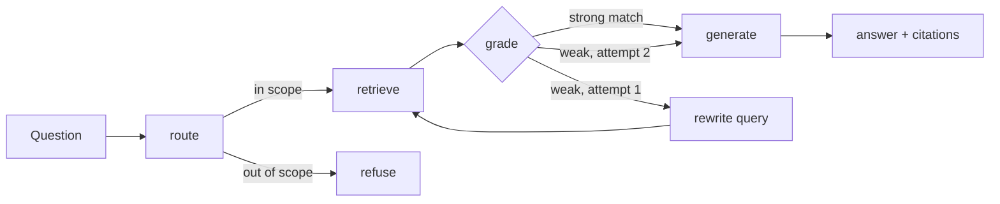

# BTU RAG agent

A question-answering service for the module catalogue of BTU Cottbus-Senftenberg (3,238 modules). Ask "How many credits is Operating Systems I?" or "Is IT Security Law taught in English?". You get an answer that cites the module records it used, or a plain "not in the catalogue".

It is built as an evaluated RAG system, not a demo: a LangGraph agent, a FastAPI service, and an eval suite with a hand-checked golden set that gates CI.

**Stack:** Python 3.12 · LangGraph · FastAPI · Anthropic Claude (`claude-opus-5-5`) · pytest · GitHub Actions

## How it works



| Node | What it does |
| --- | --- |
| **route** | Claude turns the question into a structured search request (topic words, module numbers, level, language, semester, programme) using JSON-schema structured output, and flags out-of-scope questions. Without an API key, a rule-based parser does this instead. |
| **retrieve** | BM25 over the English and German module titles, with structured filters and exact matching on five-digit module numbers. Results are ranked by query coverage first, then BM25. |
| **grade** | Checks evidence strength: does the top hit match at least half of the query terms? If not, the graph loops through **rewrite** once, where Claude rephrases the query (translation, synonyms, the likely official title). |
| **generate** | Claude answers only from the records, citing each fact as `[module id]`. Records are passed as data inside `<records>`, so text in a question can't override them. Citations to ids that weren't in the evidence are dropped. |

**Key-free mode:** with no API key, the same graph runs and returns the matching records as a list instead of a generated answer. Tests and CI use this mode.

**Refusals:** model requests use the API's server-side fallback (`fallbacks="default"`). If the model still declines, the agent falls back to listing the records instead of failing.

## Evaluation

The golden set ([btu_rag/eval/golden.jsonl](btu_rag/eval/golden.jsonl)) has 32 hand-checked cases. Each case has the module ids that count as correct and the facts the answer must contain. They cover credits, language, exam type, schedule, participant limits, German-language questions, abbreviations (DBMS, ML), duplicate titles, a prompt-injection attempt, an unanswerable question and out-of-scope questions.

| Metric | What it measures | Mode |
| --- | --- | --- |
| hit@1, hit@5, recall@5, MRR | Did retrieval find the right module, and how high did it rank it? | retrieval, agent |
| abstention accuracy | Did it answer answerable questions and decline the rest? | retrieval, agent |
| fact recall | Are the expected facts (e.g. "8" credits, whole-number match) in the answer? | agent |
| citation precision | Is every cited module one the model was actually shown? | agent |
| faithfulness | LLM judge splits the answer into claims and checks each against the records | agent `--judge` |

```bash
python -m btu_rag.eval --mode retrieval          # free, deterministic; runs in CI
python -m btu_rag.eval --mode agent --judge      # full pipeline + LLM judge (needs ANTHROPIC_API_KEY)
python -m btu_rag.eval --only hard               # one slice of the set
```

Each run writes a JSON and a Markdown report to `reports/` and exits non-zero if a metric drops below its gate.

**Current baseline (retrieval mode, rule-based routing):**

| hit@1 | hit@5 | MRR | abstention |
| --- | --- | --- | --- |
| 0.857 | 0.964 | 0.911 | 0.50 |

The failures are deliberate hard cases. They show where lexical retrieval with rule-based routing stops working:
- *"a course about recognising emotions in people's faces"*: a paraphrase that shares no words with "Facial Expression Recognition with Deep Learning".
- *"What's the weather in Cottbus tomorrow?"*, *"What time does the Mensa open?"*: the rules can't tell that these are out of scope, and "weather" matches a real climate module.

Agent mode targets exactly these cases: the Claude router flags out-of-scope questions, and the rewrite step handles paraphrases. Run `--mode agent --judge` with a key to measure how many it fixes.

## Run it

```bash
python3.12 -m venv .venv && source .venv/bin/activate
pip install -e ".[dev]"
pytest -q
export ANTHROPIC_API_KEY=...   # optional; without it answers are key-free record lists
uvicorn btu_rag.api:app --reload
```

```bash
curl -s localhost:8000/ask -H 'content-type: application/json' \
  -d '{"question": "Is there a participant limit for Foundations of Data Mining?"}'
```

| Endpoint | Purpose |
| --- | --- |
| `POST /ask` | Answer, mode (`generated` / `extractive` / `no_evidence` / `out_of_scope`), citations, sources, graph trace, latency |
| `GET /search?q=&level=&language=&semester=` | Raw retrieval results with scores |
| `GET /modules/{id}` | One module record |
| `GET /health` | Catalogue size and date, answer mode |

Interactive docs are at `/docs`.

| Setting | Default |
| --- | --- |
| `BTU_RAG_MODEL` / `BTU_RAG_JUDGE_MODEL` | `claude-opus-5-5` |
| `BTU_RAG_EFFORT` | `low` (routing and short answers don't need deep reasoning) |
| `BTU_RAG_FALLBACKS` | `1` (set `0` to disable server-side refusal fallback) |
| `BTU_RAG_TOP_K` | `5` |

## Design notes

- **Why BM25 and not embeddings?** Module titles are short, exist in two languages, and questions usually name the module. Lexical search is exact, explainable (coverage shows which terms matched) and free to run in CI. The eval set makes it measurable when that stops being true; the paraphrase case is the first sign.
- **Why a graph?** The retry loop, the out-of-scope branch and key-free mode are explicit edges you can test one by one. Tests drive every path with a scripted fake model, so no API calls are needed.
- **Why gate on a golden set?** A change to stopwords or ranking can quietly break other queries. `test_retrieval_eval_meets_its_gates` fails the build when that happens.

## Data

`data/mofi-catalog.json` is the MOFI catalogue snapshot (generated 2026-10-05, schedule semester WiSe 26/27), the same data used by [myBTU](https://mybtu.vercel.app/). Always check the official module pages before registering.

## Next steps

- Add hybrid retrieval (BM25 + multilingual embeddings) and compare it on the `paraphrase` slice.
- Pull in more sources: timetables, exam dates, prerequisites from module descriptions.
- Track eval scores over time in CI and add per-case cost and latency budgets.
